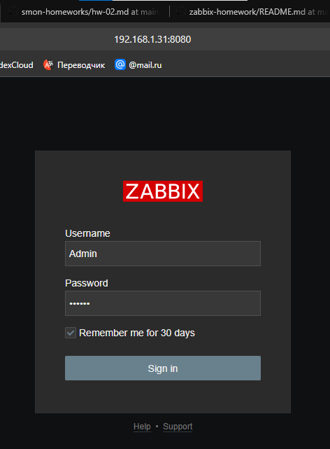
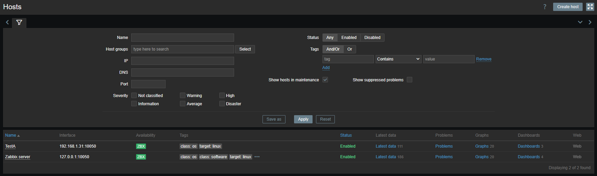
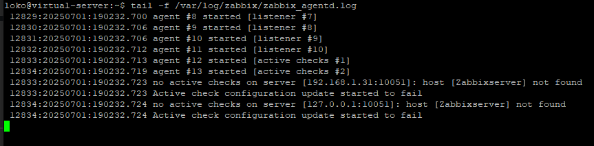
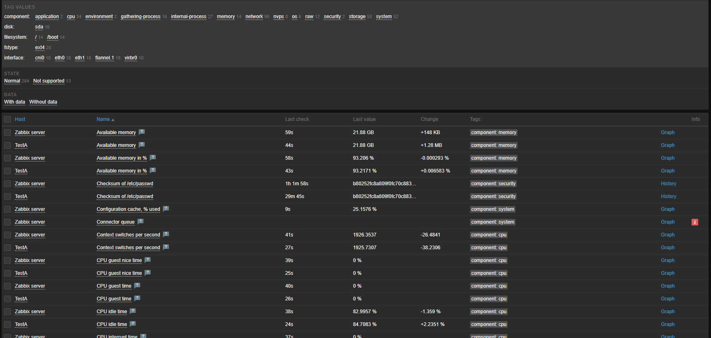

# Задание к занятию "`Система мониторинга Zabbix`"


---

### Задание 1 

`Установите Zabbix Server с веб-интерфейсом.`

 `Версия Zabbix: 7.0 LTS`
 `ОС Ubuntu`
 `Версия 24.04`
 `БД: PostgreSQL`
 `Apache`

```
$ sudo apt update`
$ sudo apt install postgresql`
$ wget https://repo.zabbix.com/zabbix/7.0/ubuntu/pool/main/z/zabbix-release/zabbix-release_latest_7.0+ubuntu24.04_all.deb`
$ sudo dpkg -i zabbix-release_latest_7.0+ubuntu24.04_all.deb`
$ sudo apt update`
$ sudo apt install zabbix-server-pgsql zabbix-frontend-php php8.3-pgsql zabbix-apache-conf zabbix-sql-scripts`
$ sudo -u postgres createuser --pwprompt zabbix`
$ sudo -u postgres createdb -O zabbix zabbix`
$ sudo zcat /usr/share/zabbix-sql-scripts/postgresql/server.sql.gz | sudo -u zabbix psql zabbix
$ systemctl restart zabbix-server apache2
$ systemctl enable zabbix-server apache2
$ systemctl status zabbix-server.service`
$ sudo nano /etc/apache2/ports.conf
$ sudo kill -9 $(sudo lsof -i :8080)
$ systemctl restart zabbix-server apache2
```



---

### Задание 2

`Установите Zabbix Agent на два хоста.`

```
$ sudo apt update
$ sudo apt install zabbix-agent
$ sudo nano /etc/zabbix/zabbix_agentd.conf
$ sudo systemctl restart zabbix-agent.service
$ systemctl status zabbix-agent.service
```





---
